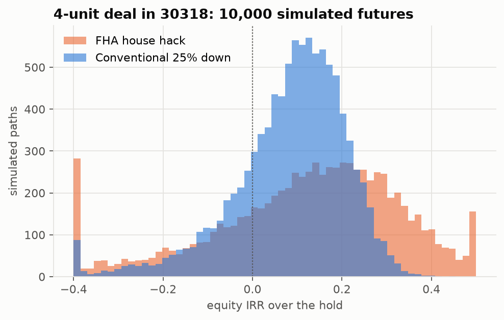
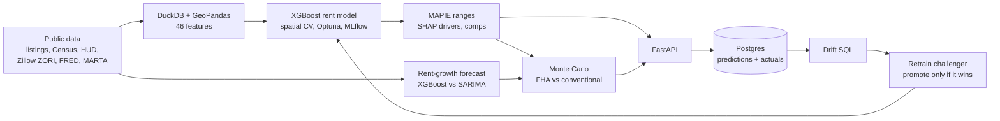

# Small Multifamily Deal Analyzer

**[▶ Try the live demo](https://atlanta-deal-analyzer.streamlit.app/)**: type an Atlanta address and get the full analysis.

**Should I buy this 2–4 unit property in Atlanta?** This project answers that with a rent estimate *and* an honest range, the reasons behind it, comparable listings, a rent-growth forecast, and 10,000 simulated futures comparing an FHA house hack against a conventional investor loan. It is served as an API (FastAPI + Postgres in Docker).



## Results at a glance

| Question | Answer |
|---|---|
| How accurate is the rent model? | XGBoost test MAE **$155** (MAPE 12.4%) on the newest 20% of listings, **30% lower than a ZIP × bedrooms median baseline** (95% CI 25–35%) |
| Are the ranges honest? | 80% conformal ranges cover **78.9%** of test rents (median width $475) |
| Do 3–4 unit buildings rent for less? | Yes: **−15.3%** vs 5+ unit buildings (95% CI −21% to −9%), Census PUMS 2022–2024 |
| Can we forecast rent growth? | XGBoost beat SARIMA (5.4 vs 6.5 pp MAE, 2022–24 backtest), but a plain no-change forecast beat both in that flat market, and failed the 2019 boom. Lesson: show the uncertainty, don't trust a point forecast |
| What does a typical deal look like? | 4-unit in ZIP 30318 at $660k: FHA fails the self-sufficiency test and loses money in year 1 on 96% of simulated paths; conventional 33% |
| Does it notice when it goes stale? | A SQL drift check flags a simulated +15% rent jump (coverage 79% → 63%); the retrained challenger beat the champion (MAE $278 → $243, CI of gain 10–16%) and was promoted. On real late-2019 data nothing was flagged and a forced retrain did *not* win, so the champion stayed |
| Where does the deal break? | Conventional fourplex: year-1 cash flow turns negative below $1,632/unit rent, above 20% vacancy or above a 9.2% mortgage rate (SciPy root-finding). Rent growth and rent level dominate the IRR |
| Is it fast enough to serve? | `/predict` ~0.15 s, `/simulate` (10K paths × 2 loans) ~0.3 s |

## How it works



| Phase | What I did | Write-up |
|---|---|---|
| 1. Data | 4,299 Atlanta listings joined to Census ACS, HUD rents, Zillow ZORI, FRED rates | `src/pipeline.py` |
| 2. EDA + hypothesis | Cleaning rules, spatial features (distance to downtown/MARTA, tract stats), weighted regression on Census microdata | [phase 2](reports/phase2_findings.md) |
| 3. Validation | Newest-20% time holdout + spatial CV (random CV flattered the baseline: $227 vs $314) | [phase 3](reports/phase3_findings.md) |
| 4. Models | Ridge and XGBoost, Optuna tuning, MLflow registry | [phase 4](reports/phase4_findings.md) |
| 5. Text model | Fine-tuned MiniLM on listing text: better CV, no test gain, **not adopted** | [phase 5](reports/phase5_findings.md) |
| 6. Explain | Conformal ranges (location-aware calibration), SHAP drivers, nearest comps | [phase 6](reports/phase6_findings.md) |
| 7. Forecast | 12-month ZIP rent growth, 856-forecast backtest | [phase 7](reports/phase7_findings.md) |
| 8. Simulation | Vectorized Monte Carlo (rent, vacancy, inflation, capex, rates), 2019 backtest | [phase 8](reports/phase8_findings.md) |
| 9. API | FastAPI + Postgres in Docker Compose; every prediction logged for drift monitoring | [decisions](docs/DECISIONS.md#phase-9-api--postgres) |
| 10. Monitoring | Rent actuals, SQL drift check (monthly MAE + coverage), champion/challenger retraining with the MLflow Model Registry | [phase 10](reports/phase10_findings.md) |
| 11. Break-evens + report | Tornado chart, SciPy break-evens, Quarto findings report with model card, Streamlit demo | [findings report](reports/findings.md) |

**Full write-up with model card: [reports/findings.md](reports/findings.md).** Every design choice and the reasoning behind it is in [docs/DECISIONS.md](docs/DECISIONS.md).

## Try it

**Online:** https://atlanta-deal-analyzer.streamlit.app/ (Streamlit Community Cloud; redeploys on every push to `main`, and may take a minute to wake up). The model and serving data are downloaded from the [artifacts repo](https://huggingface.co/kev1nmo/deal-analyzer-artifacts) on first start.

**Locally:**

```bash
docker compose up -d --build
```

- **Demo app:** http://localhost:8501 (Streamlit: type an address or pick an example; every number comes from the API)
- **Without Docker:** `streamlit run app/streamlit_app.py` runs the API inside the app (downloads the model on first start)
- **API docs:** http://localhost:8000/docs

Or call the API directly:

```bash
curl -X POST localhost:8000/predict -H 'content-type: application/json' \
  -d '{"latitude": 33.7866, "longitude": -84.4149, "bedrooms": 2, "bathrooms": 1, "square_feet": 950}'
```

```json
{"zip": "30318", "predicted_rent": 1396, "rent_today": 1790, "range_today_low": 1384, "range_today_high": 2337,
 "drivers": [{"feature": "bathrooms", "effect_pct": -5.4}, "..."], "comps": ["..."]}
```

| Endpoint | Returns |
|---|---|
| `POST /predict` | Rent (2019 model, rolled to today with ZORI), 80% range, top 5 SHAP drivers, 5 comps |
| `POST /simulate` | P10 / median / P90 of NOI, cap rate, DSCR, cash-on-cash, IRR, and P(negative cash flow) for both loans |
| `POST /breakeven` | Tornado (each input at its simulated p10/p90) and SciPy break-evens for both loans |
| `POST /actuals` | Records the real rent for a past prediction |
| `GET /drift` | Monthly MAE, coverage and drift flags |
| `GET /predictions` | Recent logged requests |
| `GET /health` | Model version and database status |

The API needs the data and trained model from the pipeline below (they are not committed).

## Run the pipeline

```bash
conda create -n deal-analyzer python=3.11 -y
conda activate deal-analyzer
pip install -r requirements.txt
conda install -c conda-forge llvm-openmp -y
cp .env.example .env
```

Add free [FRED](https://fred.stlouisfed.org/docs/api/api_key.html) and [Census](https://api.census.gov/data/key_signup.html) API keys to `.env`, then:

```bash
python -m src.pipeline
python -m src.phase2
python -m src.phase3
python -m src.phase4
python -m src.phase5
python -m src.phase6
python -m src.phase7
python -m src.phase8
python -m src.phase10
python -m src.phase11
quarto render reports/findings.qmd
pytest -q
```

When `/drift` flags a month, `python -m src.retrain` trains and registers a challenger and promotes it only if it wins.

89 tests cover data sources, leakage checks, metrics, conformal coverage, finance math (checked against SciPy), training/serving feature parity for the API, and the drift and promotion rules.

## Limitations

- Listings are a 2018–2019 public sample ([UCI](https://archive.ics.uci.edu/dataset/555/apartment+for+rent+classified)), about 4K rows with coarse coordinates. Today's rents are rolled forward with Zillow's index, not re-learned.
- Purchase prices are illustrative assumptions; there is no licensed sales data.
- Vacancy is national (FRED has no Atlanta series), and the 2019 backtest shows simulated ranges were too narrow for the pandemic rent spike.

## Stack

Python · pandas · DuckDB · SciPy · GeoPandas · statsmodels · scikit-learn · XGBoost · Optuna · MLflow · PyTorch / Transformers · MAPIE · SHAP · FastAPI · SQLAlchemy · PostgreSQL · Docker · Streamlit · Quarto
