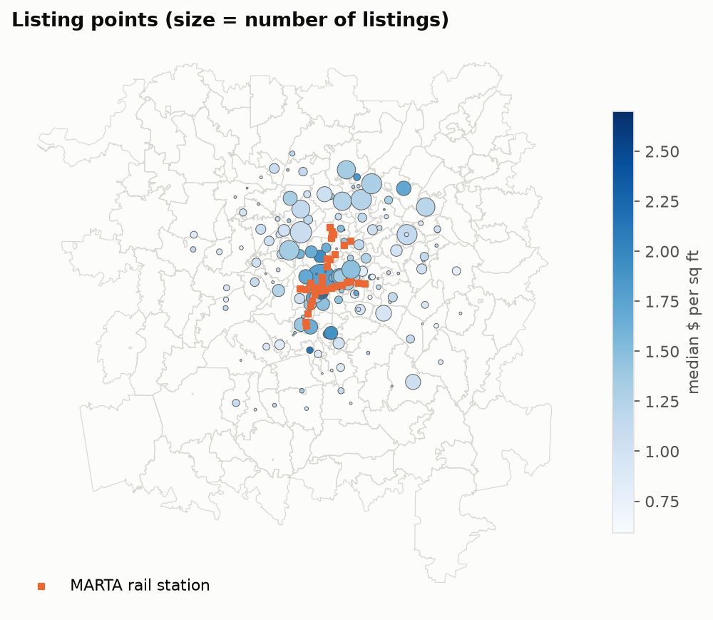
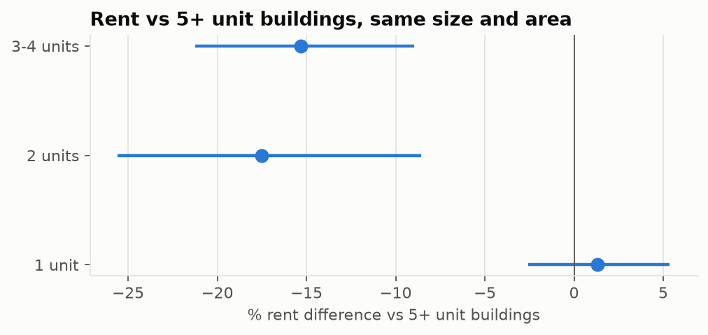
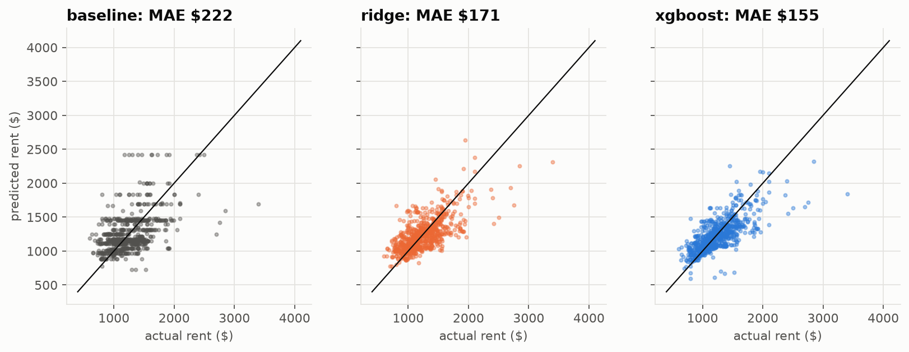
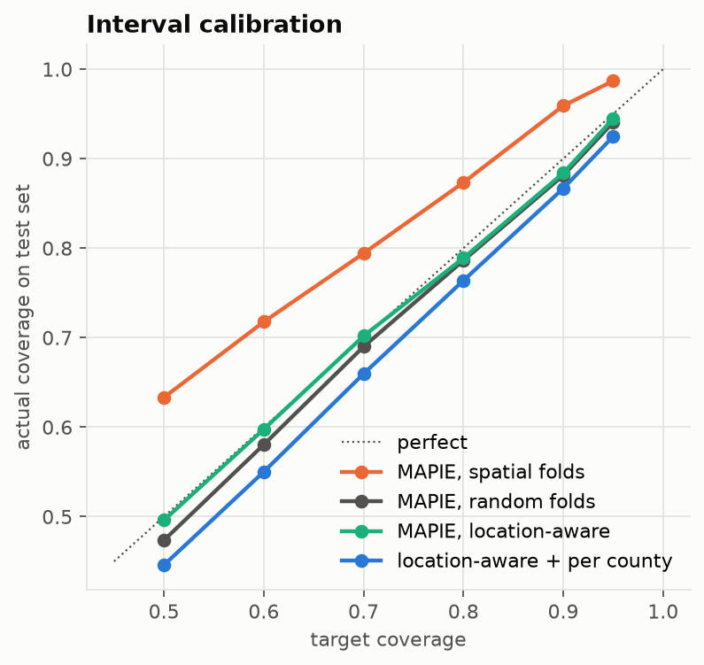
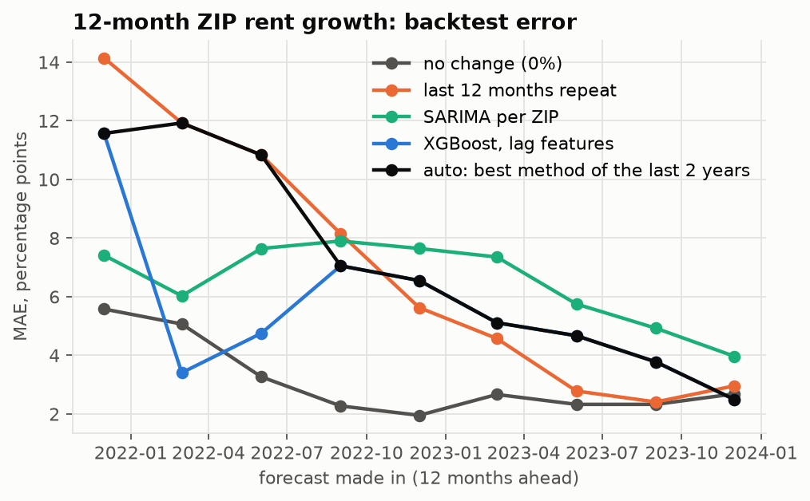
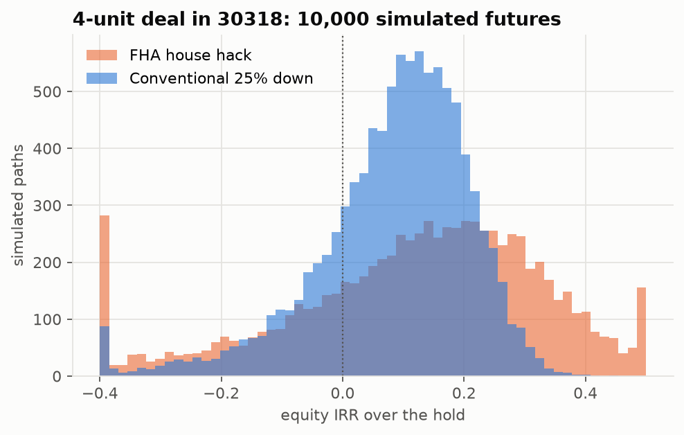
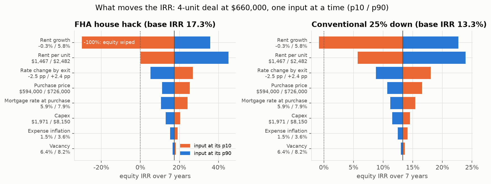

# Small Multifamily Deal Analyzer: Findings

2026-11-12

## Summary

- **Rent model:** XGBoost on 46 features predicts unit rent with a test
  MAE of **\$155** (MAPE 12.4%) on the newest 20% of listings, **30.1%
  lower than a ZIP × bedrooms median baseline** (95% CI 25.3–34.7%).
- **Honest ranges:** 80% conformal ranges cover **78.9%** of test rents
  (median width \$475). Fulton County under-covers (65%) because in-town
  rents shifted in late 2019.
- **Hypothesis:** units in 3–4 unit buildings rent **15.3% less** than
  in 5+ unit buildings (95% CI −21.2% to −9.0%), from Census microdata.
- **Rent growth:** XGBoost beat SARIMA (5.41 vs 6.47 pp MAE) in a
  2022–24 backtest, but a no-change forecast beat both (3.09 pp) and
  then failed the 2019 boom test. XGBoost shipped as the only option
  robust in both regimes.
- **Deal simulation:** for a West Midtown fourplex at \$660k, FHA fails
  the self-sufficiency test and is cash-flow negative in year 1 on ~96%
  of paths vs ~33% for a conventional loan. A 2019 backtest shows the
  simulated ranges were too narrow for the pandemic rent spike.
- **Break-evens:** the conventional deal’s year-1 cash flow turns
  negative below **\$1,632/unit** rent, above **20% vacancy**, or above
  a **9.2%** mortgage rate. Rent growth and rent level dominate the IRR.
- **Operations:** served by FastAPI + Postgres in Docker. A SQL drift
  check flagged a simulated +15% rent shock, and the retrained
  challenger was promoted only because it won (MAE \$278 → \$243).

## 1. Data

| Source | Use |
|----|----|
| UCI “Apartment for Rent Classified” listings | 4,299 Atlanta-area listings, Dec 2018 – Dec 2019 → 3,792 after cleaning |
| Census ACS (tract, ZCTA) and PUMS microdata | Neighborhood income, rent, renter share, vacancy; building-size hypothesis |
| HUD Small Area Fair Market Rents | ZIP × bedroom reference rent |
| Zillow ZORI | ZIP rent index: market level at listing, rent growth target, roll-forward to today |
| FRED | Mortgage rates, CPI, rental vacancy |
| MARTA GTFS | Distance to rail |

Limitations: the listing sample is ~4K rows, not the ~20K planned.
Coordinates are coarse (158 unique map points), and 233 listings sit on
a city-wide geocoder fallback point. Cleaning removed reposts,
implausible sizes, rent-per-sq-ft outliers, and fixed 110 mislocated
listings.



## 2. Building-size hypothesis

The listings have no building-size field, so the test uses ACS PUMS
2022–2024 renter households in the five core counties. A weighted
regression of log rent on building size controls for bedrooms, rooms,
decade built, PUMA, and year (HC1 errors).

| Building      | Effect vs 5+ units | 95% CI              |
|---------------|--------------------|---------------------|
| 1 unit        | +1.3%              | not significant     |
| 2 units       | −17.5%             |                     |
| **3–4 units** | **−15.3%**         | **−21.2% to −9.0%** |

Robust to unweighted (−12.2%), PUMA-clustered errors (−15.3%), and gross
rent (−10.3%).



## 3. Validation design

- **Time holdout:** newest 20% (758 listings after 2019-09-18) is the
  test set, opened once per phase.
- **Spatial CV:** 40 KMeans clusters on map points → 5 grouped folds.
  Random CV flattered the ZIP baseline (\$227 vs \$314 MAE) because ZIP
  identity doesn’t transfer to new neighborhoods.

## 4. Rent model

| Model | Spatial CV MAE | Test MAE | Test MAPE | Gain vs baseline (95% CI) |
|----|---:|---:|---:|----|
| ZIP × beds median (baseline) | \$314 | \$222 | 18.2% |  |
| Ridge | \$243 | \$171 | 14.1% | 22.9% (17.6–28.0%) |
| **XGBoost** | **\$233** | **\$155** | **12.4%** | **30.1% (25.3–34.7%)** |

The winner was chosen on CV before test was opened. Ablation (CV MAE
increase when a group is dropped): size +\$31, listing +\$14, nearby
rent +\$11, neighborhood +\$8, location +\$6, market +\$5.

By county, test MAE is Cobb \$139, Fulton \$219, Gwinnett \$90. By price
band: \<\$1k \$149, \$1.0–1.3k \$102, \$1.3–1.6k \$168, \$1.6k+ \$347
(underpredicts luxury units by ~\$300).

**Text model (not adopted):** a fine-tuned MiniLM score from listing
descriptions improved spatial CV (\$233 → \$207) but not test (\$155 →
\$157, CI −4.8% to +2.2%). Text mostly stood in for location knowledge.



## 5. Ranges, drivers, comps

| Calibration                  | Test coverage @ 80% | Median width |
|------------------------------|--------------------:|-------------:|
| Spatial folds                |               87.3% |        \$621 |
| Random folds                 |               78.6% |        \$462 |
| **Location-aware (shipped)** |           **78.9%** |    **\$475** |
| Location-aware + per county  |               76.4% |              |

Location-aware uses random-fold calibration at known map points and
spatial-fold calibration at new ones. Known points cover 77.4% and new
points 90%. By county: Cobb 81%, Fulton 65%, Gwinnett 92%, DeKalb 71% (n
= 34).

Top SHAP drivers (mean \|effect\| as % of rent): square feet 5.1,
bathrooms 4.5, nearby rent per sq ft 4.4, log sq ft 3.1, km to MARTA
2.1, ZORI 2.1.



## 6. Rent-growth forecast

12-month ZIP rent growth, forecast quarterly from Dec 2021 to Dec 2023
(856 forecasts):

| Method                | 2022–24 MAE (pp) | 2019 backtest: ZIPs inside 80% band |
|-----------------------|-----------------:|------------------------------------:|
| No change             |             3.09 |                                  2% |
| **XGBoost (shipped)** |         **5.41** |                             **44%** |
| SARIMA                |             6.47 |                                     |
| Auto-select           |             6.98 |                                 44% |

XGBoost vs SARIMA: −1.06 pp (95% CI −1.39 to −0.71). The lesson is that
in regime changes, the uncertainty band and the break-evens matter more
than the point forecast.



## 7. Monte Carlo deal simulation

10,000 paths × 2 loans in 0.17 s. Each path draws the rent level (from
the conformal range), rent growth (Phase 7), vacancy and inflation
(AR(1) on FRED), capex shocks, and the rate path (which drives the exit
cap).

Phase 8 example (4-unit in 30318, \$660k, ~\$1.7k/unit): FHA fails
self-sufficiency. P(negative year-1 cash flow) is 99.7% for FHA vs 40.6%
for conventional; median IRR is 14.8% vs 10.3%.

**2019 backtest:** only 44% of ZIPs’ actual 2019–2024 rent growth fell
inside the simulated 80% band. The median ZIP sat at the 93rd
percentile, because nothing in pre-2019 data foresaw the pandemic rent
spike. For the example deal, outcomes re-run with actual drivers landed
mid-distribution (35th–60th percentile).



## 8. Break-evens and sensitivity

Example: the same fourplex today at \$1,900/unit (80% range
\$1,467–\$2,482). Each input is moved to its own simulated p10/p90 with
everything else at the median.



|  | Conventional 25% down | FHA house hack |
|----|----|----|
| Median-path IRR | 13.3% | 17.3% |
| Year-1 cash flow | +\$10.0k | −\$20.3k |
| Rent break-even (year-1 CF) | below \$1,632/unit | needs above \$2,626/unit |
| Vacancy break-even | above 20.4% | negative at any vacancy |
| Rate break-even | above 9.2% | needs below 2.5% |
| Price break-even | above \$791k | needs below \$448k |
| IRR \< 0 when | growth \< −0.1%/yr or rent \< \$1,131 | growth \< 1.2%/yr or rent \< \$1,465 |

FHA’s higher median IRR is leverage: with 3.5% down, a few flat years
can wipe out the equity at sale (IRR −100% at p10 rent growth).

## 9. Serving and monitoring

- **API:** FastAPI `/predict` (~0.15 s), `/simulate` (~0.3 s),
  `/breakeven` (~0.5 s), `/actuals`, `/drift`. Serving features are
  rebuilt from raw inputs with the training code, and a test confirms
  they match training features exactly.
- **Postgres** logs every prediction (with its feature vector and model
  version), simulation, and actual rent.
- **Drift rule:** monthly MAE \> 1.25 × \$155, or 80% coverage \< 70%,
  with at least 30 actuals.

| Drill | Drift? | Champion → challenger MAE | Decision |
|----|----|----|----|
| Late-2019 replay, real rents | No (Sep \$147 / 79%, Dec \$189 / 79%) | \$185 → \$187 (gain CI −3.8% to +2.1%) | keep champion |
| Same, rents +15% | Yes (Sep coverage 63%) | \$278 → \$243 (gain 12.5%, CI 9.8–15.5%) | promote |

## Model card

**Model:** `rent-model`, an XGBoost regressor on log(rent) inside a
scikit-learn pipeline, with a nearby-rent feature computed inside the
pipeline to avoid leakage. Hyperparameters were tuned with Optuna on
spatial CV: 400 trees, depth 5, learning rate 0.030. Ranges come from
MAPIE CV+ with location-aware calibration. Artifact version
`ba6d8bed820c`.

**Intended use:** screening the market rent of a typical unit in a 2–4
unit property in metro Atlanta before making an offer, together with an
80% range, the main drivers, and comparable listings.

**Not for:** appraisal or lending decisions; tenant screening or any
decision about individual people; properties outside the metro bounding
box, units with more than 4 bedrooms, or luxury units (above \$1.6k, it
underpredicts by ~\$300).

**Training data:** 3,034 cleaned listings from Dec 2018 – Sep 2019 (UCI
public dataset), joined to Census, HUD, Zillow and FRED data at listing
time. Rents today are the 2019 prediction rolled forward with the ZIP’s
Zillow index, not re-learned.

**Evaluation:** time holdout of 758 listings (Sep – Dec 2019). MAE
\$155, MAPE 12.4%, median absolute error \$115. 80% coverage 78.9%. By
county: Fulton is the weakest (MAE \$219, coverage 65%).

**Fairness considerations:** location features (tract income, renter
share, distance to transit) correlate with neighborhood demographics, so
predictions reproduce existing market rent gaps between neighborhoods.
That is appropriate for estimating market rent, but the model must not
be used to screen or price individual tenants.

**Monitoring:** every prediction is logged. Monthly MAE and coverage are
checked against thresholds, and a challenger is promoted only if it
beats the champion on recent data with a 95% CI above zero.

**Known limitations:** small, coarse, single-year listing sample;
national vacancy series; purchase prices are assumptions; simulated
rent-growth ranges were too narrow for the 2021–22 spike.

## Reproduce

``` bash
python -m src.pipeline && python -m src.phase2 && python -m src.phase3 && python -m src.phase4
python -m src.phase5 && python -m src.phase6 && python -m src.phase7 && python -m src.phase8
docker compose up -d --build
python -m src.phase10 && python -m src.phase11
quarto render reports/findings.qmd
```
