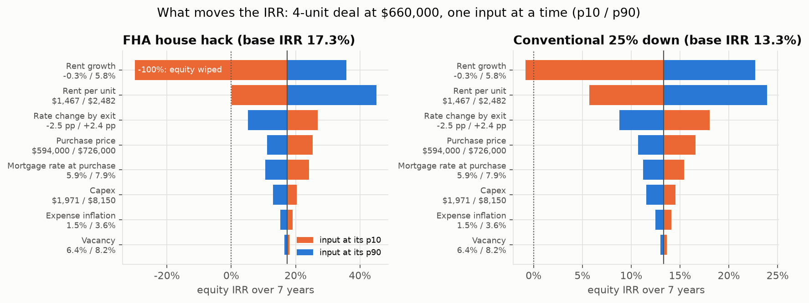

# Phase 11 findings: what drives the deal, and where it breaks

Example: a 4-unit property in ZIP 30318 at $660,000, every unit a 2 BR / 1 BA, 950 sq ft. Rent today $1,904/unit (80% range $1,443-$2,452).

## Method

- Same cash-flow engine as the Phase 8 Monte Carlo, run on one deterministic path: every driver held at its median, then **one input at a time moved to its own p10 and p90** from the 10,000 simulated paths. So the tornado's ranges are the simulation's ranges, not hand-picked +/-10% swings. Mortgage rate (+/-1 pp) and price (+/-10%) are deal terms, not forecasts, so they get fixed swings.
- Break-evens: SciPy `brentq` solves for the input value where year-1 cash flow (or 7-year IRR) hits zero, holding everything else at the median. A grid scan first finds the sign change closest to today's value, so the root is bracketed. If losses exceed the down payment, IRR is undefined; it is scored as -100%.

Input ranges (from the simulation):

| input            | p10      | median   | p90      |
|:-----------------|:---------|:---------|:---------|
| rent             | $1,467   | $1,900   | $2,482   |
| vacancy          | 6.4%     | 7.3%     | 8.2%     |
| growth           | -0.3%    | 2.8%     | 5.8%     |
| inflation        | 1.5%     | 2.6%     | 3.6%     |
| capex            | $1,971   | $4,442   | $8,150   |
| exit_rate_change | -2.5 pp  | -0.0 pp  | +2.4 pp  |
| rate             | 5.9%     | 6.9%     | 7.9%     |
| price            | $594,000 | $660,000 | $726,000 |

## FHA house hack

Median path: year-1 cash flow $-20,337, 7-year IRR 17.3%.

Biggest IRR swings: rent growth (136% pts), rent per unit (45% pts), rate change by exit (22% pts).

Break-evens:

- year-1 cash flow turns positive above $2,626 rent per unit (now $1,900)
- year-1 cash flow stays negative at any vacancy
- year-1 cash flow turns positive below 2.5% mortgage rate at purchase (now 6.9%)
- year-1 cash flow turns positive below $447,508 purchase price (now $660,000)
- IRR turns negative below 1.2% rent growth (now 2.8%)
- IRR turns negative below $1,465 rent per unit (now $1,900)

## Conventional 25% down

Median path: year-1 cash flow $10,014, 7-year IRR 13.3%.

Biggest IRR swings: rent growth (24% pts), rent per unit (18% pts), rate change by exit (9% pts).

Break-evens:

- year-1 cash flow turns negative below $1,632 rent per unit (now $1,900)
- year-1 cash flow turns negative above 20.4% vacancy (now 7.3%)
- year-1 cash flow turns negative above 9.2% mortgage rate at purchase (now 6.9%)
- year-1 cash flow turns negative above $790,691 purchase price (now $660,000)
- IRR turns negative below -0.1% rent growth (now 2.8%)
- IRR turns negative below $1,131 rent per unit (now $1,900)

## Takeaways

- **Rent level and rent growth dominate.** Vacancy and expense inflation barely move the IRR because their simulated ranges are narrow (national data). That is a limitation, not proof they don't matter: the break-evens show how far vacancy would have to go.
- **The two loans fail in different ways.** Conventional has a cushion on year-1 cash flow; FHA is cash-flow negative while the owner occupies a unit, and with 3.5% down, a few years of flat rents can wipe out the equity at sale.
