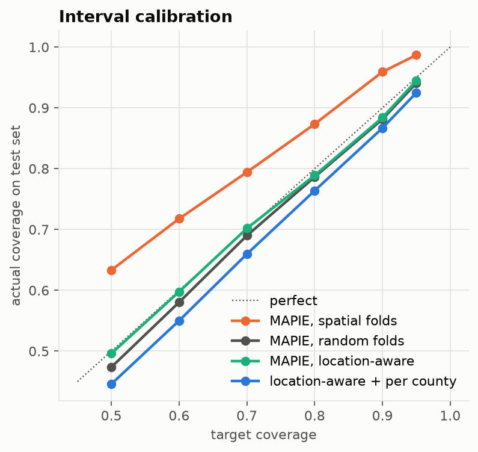
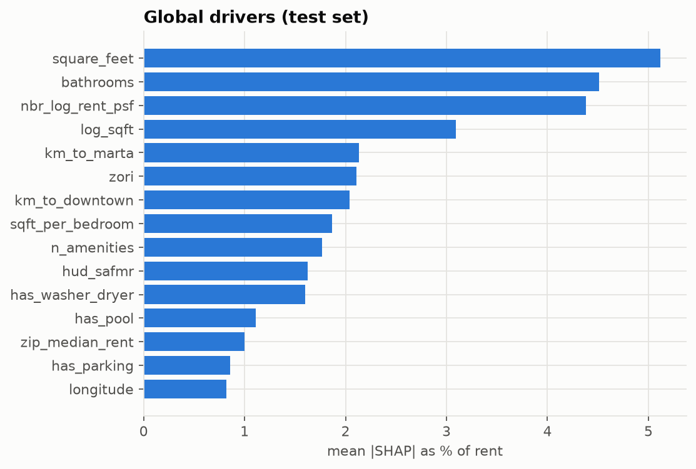

# Phase 6 findings: ranges, drivers, comps

## 1. 80% rent ranges (MAPIE cross-conformal, CV+)

The Phase 4 XGBoost model is wrapped with MAPIE `CrossConformalRegressor` (method `plus`) on log(rent). Ranges therefore scale with price: a $2,000 unit gets a wider dollar range than a $900 unit. Calibration uses training data only, in two ways:

- **spatial folds**: errors when the neighborhood is new (the Phase 3 folds).
- **random folds**: errors when the location is already known.
- **location-aware** (used by `analyze()`): random-fold ranges for listings at a map point seen in training, spatial-fold ranges for new points. This rule was set from the problem setup, not tuned on the test set.
- **location-aware + per county** (Mondrian conformal, tried, not adopted): the same idea, but the range width is the conformal quantile of out-of-fold log errors *within each county* (counties with < 100 training listings are pooled as Other). MAPIE 1.x has no Mondrian option, so this is implemented directly from out-of-fold residuals. It exists because the spec asks for ~80% per region, and one shared width under-covers the hard in-town areas.

### Test coverage at the 80% target

| group   |   listings |   spatial_coverage |   spatial_median_width |   random_coverage |   random_median_width |   location_aware_coverage |   location_aware_median_width |   mondrian_coverage |   mondrian_median_width |
|:--------|-----------:|-------------------:|-----------------------:|------------------:|----------------------:|--------------------------:|------------------------------:|--------------------:|------------------------:|
| all     |        758 |              0.873 |                621.045 |             0.786 |               461.637 |                     0.789 |                       474.727 |               0.764 |                 413.033 |

| location    |   listings |   spatial_coverage |   spatial_median_width |   random_coverage |   random_median_width |   location_aware_coverage |   location_aware_median_width |   mondrian_coverage |   mondrian_median_width |
|:------------|-----------:|-------------------:|-----------------------:|------------------:|----------------------:|--------------------------:|------------------------------:|--------------------:|------------------------:|
| known point |        668 |              0.870 |                618.124 |             0.774 |               459.840 |                     0.774 |                       459.840 |               0.750 |                 399.750 |
| new point   |         90 |              0.900 |                649.987 |             0.878 |               489.005 |                     0.900 |                       649.987 |               0.867 |                 507.507 |

Reading the coverage numbers: with n listings, sampling noise alone is about +/- sqrt(0.16/n). That is +/-1.5 points overall (n=758), +/-2.9 for Fulton (n=188), +/-6.9 for DeKalb (n=34). DeKalb's 71% and Gwinnett's 92% fall within roughly 1.5 noise units of 80%. Fulton's 65% is a real shortfall.

### By county

| county   |   listings |   spatial_coverage |   spatial_median_width |   random_coverage |   random_median_width |   location_aware_coverage |   location_aware_median_width |   mondrian_coverage |   mondrian_median_width |
|:---------|-----------:|-------------------:|-----------------------:|------------------:|----------------------:|--------------------------:|------------------------------:|--------------------:|------------------------:|
| Cobb     |        412 |              0.893 |                592.004 |             0.811 |               445.675 |                     0.813 |                       456.741 |               0.777 |                 377.023 |
| Fulton   |        188 |              0.787 |                675.356 |             0.649 |               503.541 |                     0.649 |                       511.443 |               0.723 |                 566.042 |
| Gwinnett |         73 |              0.973 |                637.313 |             0.918 |               466.394 |                     0.918 |                       475.076 |               0.699 |                 267.031 |
| Other    |         48 |              1.000 |                707.756 |             1.000 |               520.137 |                     1.000 |                       654.767 |               0.979 |                 542.800 |
| DeKalb   |         34 |              0.706 |                518.040 |             0.676 |               359.615 |                     0.706 |                       454.723 |               0.676 |                 393.979 |
| Clayton  |          3 |              1.000 |                677.228 |             0.667 |               484.702 |                     0.667 |                       565.658 |               0.667 |                 955.078 |

**Verdict.** The location-aware MAPIE ranges hit 78.9% overall (target 80%) with a median width of $475, against 87% and $621 for spatial-only calibration. Per-county calibration did not fix Fulton: it moved Fulton to 72% but cut Gwinnett to 70% and overall to 76%, so it was not adopted. The Fulton shortfall is a time shift, not a width problem. Late-2019 in-town listings came in below the training-period levels (Phase 3), and conformal ranges assume the future looks like the past. This is a known limitation, and it is the kind of drift Phase 10 monitoring should catch.

## 2. Drivers (SHAP)

Mean absolute SHAP value on the test set, as % of rent (top 10):

| feature          |   pct_of_rent |
|:-----------------|--------------:|
| square_feet      |          5.12 |
| bathrooms        |          4.51 |
| nbr_log_rent_psf |          4.38 |
| log_sqft         |          3.10 |
| km_to_marta      |          2.13 |
| zori             |          2.11 |
| km_to_downtown   |          2.04 |
| sqft_per_bedroom |          1.86 |
| n_amenities      |          1.77 |
| hud_safmr        |          1.63 |

## 3. Example: `RentAnalyzer.analyze()` on one test listing

Predicted $1,255, 80% range $1,026-$1,501 (known location: True). Actual rent: $1,195.

Top drivers (SHAP; effect relative to the average listing):

| feature          |   value |   effect_% |
|:-----------------|--------:|-----------:|
| nbr_log_rent_psf |    0.10 |      -4.58 |
| square_feet      | 1198.00 |       4.23 |
| bathrooms        |    2.00 |       3.94 |
| n_amenities      |   11.00 |      -3.30 |
| has_washer_dryer |    1.00 |      -2.70 |

5 comparable training listings:

|   rent |   bedrooms |   bathrooms |   square_feet | cityname   |   km_away |
|-------:|-----------:|------------:|--------------:|:-----------|----------:|
| 1190.0 |          2 |         2.0 |          1238 | Lilburn    |       0.0 |
| 1090.0 |          2 |         1.0 |          1131 | Lilburn    |       0.0 |
| 1170.0 |          2 |         1.0 |          1046 | Lilburn    |       0.0 |
| 1174.0 |          2 |         1.0 |          1046 | Lilburn    |       0.0 |
| 1350.0 |          3 |         2.0 |          1522 | Lilburn    |       0.0 |
