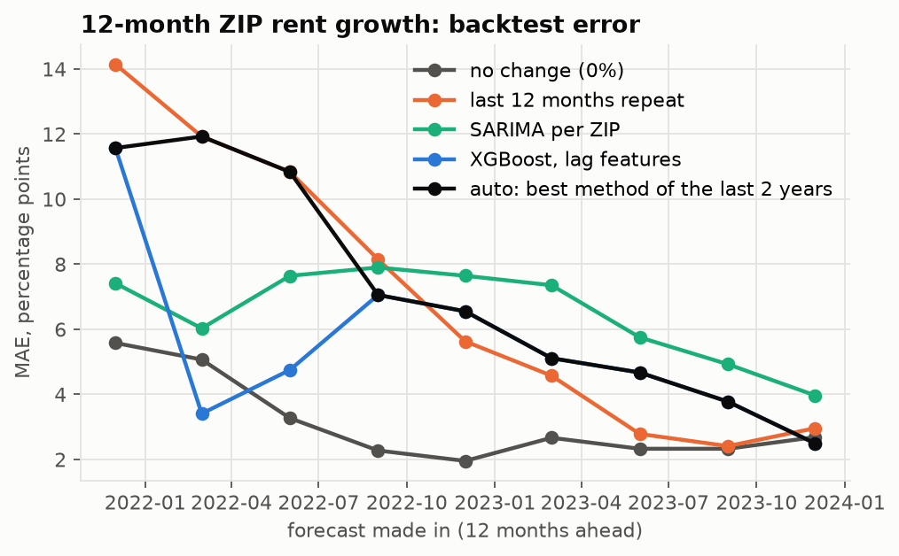

# Phase 7 findings: rent-growth forecast

Task: forecast each ZIP's rent growth over the next 12 months, using Zillow ZORI by ZIP. Forecasts were made every quarter from Dec 2021 to Dec 2023, so the forecast years cover 2022-2024. Each forecast uses only data up to its start month. That gives 856 forecasts over 104 ZIPs with at least 3 years of history. Actual 12-month growth averaged 1.8% (range -7.2% to 15.2%).

Methods:

- **SARIMA** (statsmodels): one model per ZIP on log rent, order (1, 1, 1) x seasonal (0, 1, 1, 12), refit at each origin.
- **XGBoost**: one model for all ZIPs, refit at each origin. Features: past 1/3/6/12/24-month growth, metro growth, the ZIP's rent level relative to the metro, the 30-year mortgage rate and its 12-month change, Atlanta CPI rent growth (lagged a month), and calendar month. Hyperparameters were fixed up front, not tuned: {'n_estimators': 300, 'learning_rate': 0.03, 'max_depth': 3, 'subsample': 0.8, 'colsample_bytree': 0.8, 'min_child_weight': 5}.
- Two simple reference points: no change (0%), and "the last 12 months repeat".

## Backtest MAE (percentage points of 12-month growth)

|   forecasts |   no_change |   persistence |   sarima |   xgboost |   auto |
|------------:|------------:|--------------:|---------:|----------:|-------:|
|         856 |        3.09 |          6.89 |     6.47 |      5.41 |   6.98 |

By forecast year (the year the forecast was made in):

|   year |   forecasts |   no_change |   persistence |   sarima |   xgboost |   auto |
|-------:|------------:|------------:|--------------:|---------:|----------:|-------:|
|   2021 |          89 |        5.58 |         14.14 |     7.41 |     11.57 |  11.57 |
|   2022 |         372 |        3.13 |          9.10 |     7.31 |      5.46 |   9.06 |
|   2023 |         395 |        2.50 |          3.17 |     5.47 |      3.99 |   3.99 |

XGBoost minus SARIMA MAE: -1.06 pp (95% CI -1.39 to -0.71; bootstrap over ZIPs).

**XGBoost vs. SARIMA** (the comparison the spec asks for): XGBoost wins clearly. **But the plain "no change" forecast (3.09 pp) beat both models.** Both models learned from 2016-2021, when Atlanta rents rose every year, and kept predicting growth through the 2022-2024 flattening. Tree models cannot predict outside the range they were trained on.

## Choosing what to ship

Three candidates were judged on two tests: the 2022-2024 backtest above (a flat market) and the Phase 8 2019 backtest (a boom). The second test is the share of ZIPs whose actual 2019-2024 rent growth fell inside the simulated 80% band.

| Option | 2022-24 MAE (pp) | 2019 backtest: ZIPs inside 80% band |
|---|---|---|
| No change | 3.09 | 2% |
| XGBoost | 5.41 | 44% |
| Auto-select (best method of the prior 2 years) | 6.98 | 44% (it picks XGBoost) |

- **No change** wins only in a flat market. Started in Dec 2018, it would have predicted flat rents into the 2019-2021 boom, and nearly every ZIP ended above its range.
- **Auto-select** scores no-change, persistence and XGBoost on the 2 years before each forecast date and uses the best one, with no look-ahead. It did worse than XGBoost alone, because the market turned faster than a 2-year lookback can notice: in early 2022 it picked "last 12 months repeat" right as the boom ended.

| origin   | picked                |
|:---------|:----------------------|
| Dec 2021 | XGBoost, lag features |
| Mar 2022 | last 12 months repeat |
| Jun 2022 | last 12 months repeat |
| Sep 2022 | XGBoost, lag features |
| Dec 2022 | XGBoost, lag features |
| Mar 2023 | XGBoost, lag features |
| Jun 2023 | XGBoost, lag features |
| Sep 2023 | XGBoost, lag features |
| Dec 2023 | XGBoost, lag features |

- **XGBoost (shipped)** is the only option that holds up in both a flat market and a boom. Auto-select picks it today (Sep 2026) and in Dec 2018 as well.

Lesson: in a regime change, the year-1 point forecast is unreliable whichever method makes it. What protects the deal analysis is a realistic uncertainty band (Phase 8) and break-evens (Phase 11), not a cleverer forecast.

It is exposed as `src.forecast.forecast_growth(zip, as_of)`. That returns the method used, the year-1 forecast, its error sd (from the same 2-year window), and a mean-reverting AR(1) for later years. The AR(1) is fit to annual Atlanta CPI rent growth (1999 onward, up to `as_of`). Phase 8 draws rent-growth paths from it.

Limitations: ZORI is smoothed and Zillow revises its history, so the backtest uses today's version of past data. 2022 was an unusual year: rents decelerated sharply after the 2021 spike, which no method saw coming.
