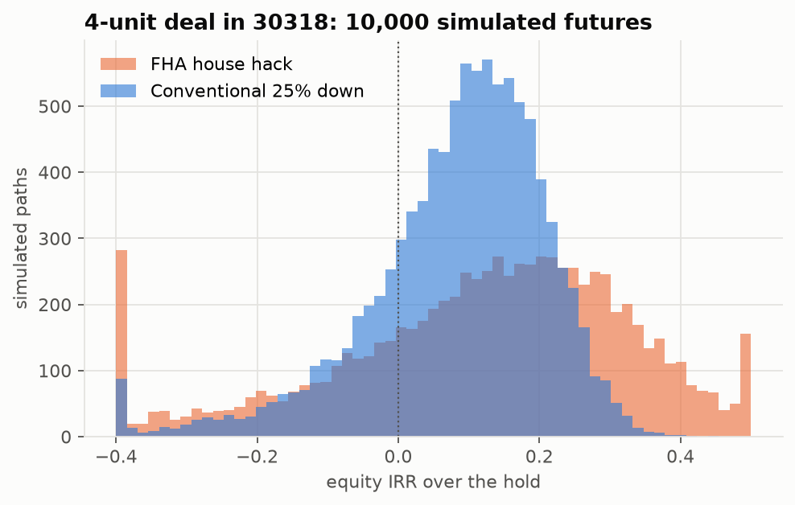
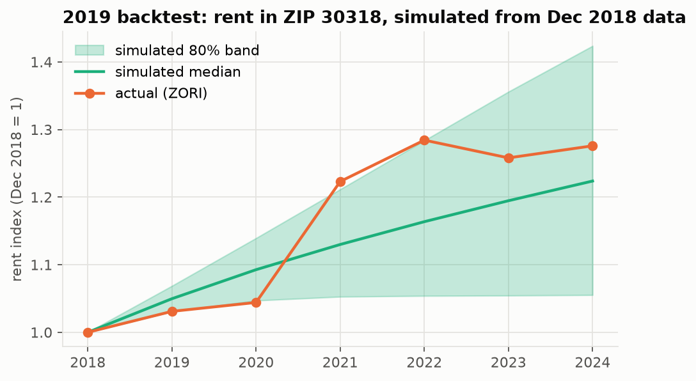

# Phase 8 findings: Monte Carlo deal simulation

## Setup

Example deal: a 4-unit property in ZIP 30318 (West Midtown, Fulton), every unit like test listing 5659918835 (2 BR, 800 sq ft). The Phase 6 analyzer predicts $1,318/month (80% range $1,118-$1,643) at 2019 prices. ZORI growth for the ZIP rolls that forward to $1,690 ($1,434-$2,107) in Sep 2026. Price $660,000 ($165,000/unit) is an **illustrative assumption**: the project has no sales data.

Each of the 10,000 paths over 7 years draws:

- **rent level** from a lognormal fitted to the 80% conformal range (one level per path).
- **rent growth** from the Phase 7 forecaster: year 1 = +2.0% +/- 2.4%, then an AR(1) that reverts to 3.1%/yr (phi 0.68, sd 2.6%), fit to Atlanta CPI rent.
- **vacancy**: an AR(1) fit to 30 years of US rental vacancy (FRED), mean 8.1%, currently 7.1%.
- **expense inflation**: an AR(1) fit to US CPI growth, mean 2.5%. It inflates taxes, insurance and capex.
- **capex shocks**: Poisson(0.25 per unit per year) events, each lognormal with a median of $3,500.
- **interest rates**: a random walk from today's 30-yr rate (6.86%) with annual sd 0.73% (FRED, 30 years). The loan is fixed-rate, so rates matter at exit: exit cap = entry cap + 0.5 x the rate change.

Operating assumptions: property tax 1.3% of price, insurance $1,500/unit/yr, maintenance 8% and management 8% of collected rent, 3% closing costs, 6% selling costs.

Financing:

- **FHA house hack**: 3.5% down, 1.75% upfront MIP (financed), 0.55%/yr annual MIP, and the owner lives in one unit for year 1 (no rent from it; the rent the owner avoids paying elsewhere is not counted).
- **Conventional investor**: 25% down; rate +0.75 pp for an investment property.

## Results (Sep 2026 deal)

Runtime: 10,000 paths x 2 financing options in 0.17 s.

| metric                  |   FHA p10 |   FHA median |   FHA p90 |   Conventional p10 |   Conventional median |   Conventional p90 |
|:------------------------|----------:|-------------:|----------:|-------------------:|----------------------:|-------------------:|
| noi_year1               | 24415.866 |    32771.906 | 42956.918 |          37414.489 |             48555.875 |          62135.891 |
| cap_rate                |     0.057 |        0.074 |     0.094 |              0.057 |                 0.074 |              0.094 |
| dscr                    |     0.685 |        0.890 |     1.138 |              0.891 |                 1.156 |              1.480 |
| cash_on_cash            |    -0.872 |       -0.598 |    -0.337 |             -0.062 |                 0.014 |              0.092 |
| irr                     |    -0.179 |        0.148 |     0.364 |             -0.079 |                 0.103 |              0.224 |
| P(negative_cf_year1)    |   nan     |        0.997 |   nan     |            nan     |                 0.406 |            nan     |
| P(negative_cf_any_year) |   nan     |        0.997 |   nan     |            nan     |                 0.688 |            nan     |

- FHA: cash in $42,900, PITI+MIP $5,764/month. **Self-sufficiency test (3-4 units): FAIL**. 75% of the units' rent ($5,071) must cover PITI.
- Conventional: cash in $184,800, PITI $4,714/month.

## 2019 backtest

The same simulation was started in Dec 2018 using only data available then: ZORI and FRED through Dec 2018, and the growth forecaster refit on that data. It ran 6 years (2019-2024), and the actual outcomes were then compared with the simulated range. The deal was priced at $120,000/unit, with rent $1,278/unit.

**Across all ZIPs** (50 with ZORI data from 2018 through 2024): the actual 2018-2024 rent growth fell inside the simulated 80% band for **44%** of ZIPs. The median ZIP sat at the 93th percentile of its simulation. Actual growth averaged +50% against a simulated median of +28%.

**Verdict.** The simulated rent-growth range was too narrow. Nothing in 2015-2018 data foresaw the 2021-22 pandemic rent spike, so most ZIPs ended near the top of their band or above it. Expense inflation (2021-23 CPI) and mortgage rates (2022 jump) also landed in the top 5-10% of the simulation. These are tail events the history-fit AR(1)/random-walk models underweight. For the example deal, though, the outcomes with actual drivers land mid-distribution: higher rents offset higher costs, and the fixed-rate loan was locked before rates rose. Takeaway for use: treat the simulated p10-p90 as narrower than reality. Phase 11's break-evens show how far each input can move.

**Drivers for this deal** (actual vs. simulated):

| driver                            |   sim_p10 |   sim_median |   sim_p90 |   actual |   actual_percentile |
|:----------------------------------|----------:|-------------:|----------:|---------:|--------------------:|
| rent index, end of 2024 (x start) |     1.055 |        1.224 |     1.424 |    1.276 |              63.720 |
| average vacancy 2019-2024         |     0.063 |        0.071 |     0.079 |    0.064 |              10.330 |
| cost index, end of 2024 (x start) |     1.105 |        1.162 |     1.222 |    1.249 |              96.580 |
| 30-yr mortgage rate, 2024         |     0.029 |        0.046 |     0.063 |    0.067 |              94.090 |

**Deal outcomes**: the deal re-run with the actual 2019-2024 drivers (rent level = point prediction, capex = expected value), compared with the simulated range:

| financing             | outcome         |     sim_p10 |   sim_median |     sim_p90 |   with_actual_drivers |   percentile |
|:----------------------|:----------------|------------:|-------------:|------------:|----------------------:|-------------:|
| FHA house hack        | noi_final       |  33,220.869 |   44,975.334 |  59,651.727 |            47,557.678 |       59.760 |
| FHA house hack        | cash_flow_total | -36,199.783 |   22,853.030 |  93,030.416 |            34,206.503 |       58.740 |
| FHA house hack        | irr             |       0.054 |        0.330 |       0.546 |                 0.255 |       34.329 |
| Conventional 25% down | noi_final       |  33,220.869 |   44,975.334 |  59,651.727 |            47,557.678 |       59.760 |
| Conventional 25% down | cash_flow_total |  18,231.169 |   79,042.606 | 151,960.383 |            90,499.678 |       58.430 |
| Conventional 25% down | irr             |       0.050 |        0.179 |       0.281 |                 0.148 |       36.784 |

Limitations: the rent level comes from a model trained on 2019 listings, a few months later than the Dec 2018 start. Vacancy is national, because FRED has no Atlanta series. Prices are assumptions. The 2019 check covers drivers and modeled outcomes, not a real property's books.
